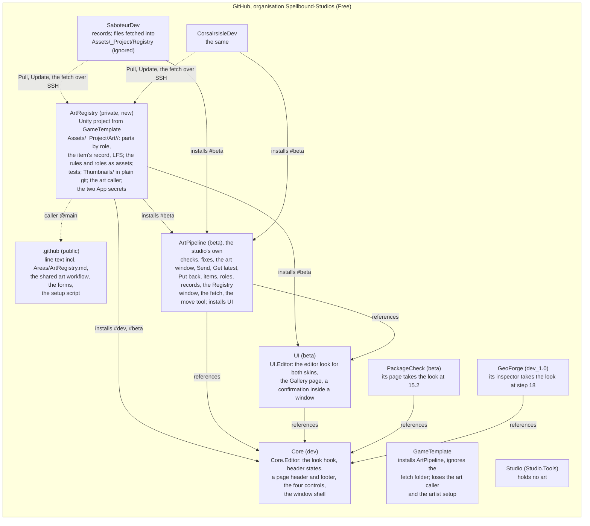

# The art registry: the design of steps 15.1 to 15.7 (2026-10-29)

Owner: the step 15 planning sessions of 2026-10-29. Binds: `Line.md`, `Roadmap.md`, the design page "Spellbound Art Registry" (https://claude.ai/artifact/BpMcZhNsptn7LG3oWP1BtQ, version 4) and the developer's answers of 2026-10-28 and 2026-10-29. Where this file and `Art.md`, `UI.md` or `Workflow.md` differ, this file wins; the three carry a revision note pointing here. The epics A5, A9, A10, UI7d, WF2c and WF1r read this file; a step's lead reads the sections that name its epic and nothing else of the pitch.

How this file was made: two plans were drawn independently from the merged line text, the live board, the repositories as merged and the design page, each attacked by four red-team readers (designer and artist, newcomer, stranger, roadmap), then compared point by point and merged; the merged plan was attacked once more. The working files, the audits, the comparison and every red-team report are in the Spellbound workspace under `Planning/ArtSend/plan-fable` and `Planning/ArtSend/plan`.

Decided inputs, beyond the page: the games' art moves into the registry in tasks after a proof and each game keeps only a record per item (the developer, 2026-10-28); Git for Windows by hand, then one line; an SSH key with no passphrase; ArtPipeline is the studio's own art tool and holds the whole art pipeline (the developer, 2026-10-28); the registry also keeps the Maya source files as a Source part outside Unity's folders (the developer, 2026-10-29).

Words: a **gate** is one story a person reviews and signs off; a **step** is one batch of stories in the Roadmap's step table; an **item** is one piece of art a game can pull, a folder in the registry with a record; a **part** is one kind of file an item carries, sorted by its **role** (the model, the Maya source, later an icon or a sound); a **record** is a game's small asset naming an item and the version it uses.

## 1. The shape

### 1a. Repositories and what each holds



| Thing | Lives in | Why there |
|---|---|---|
| The items (models, textures, materials, later icons and sounds), their records, the rules and roles as assets, the registry's tests, the thumbnails, the destination settings | ArtRegistry, a private repository that is a Unity project | The page: all art in one registry with its own Unity project |
| The checks and fixes, the art window with its Send tab, Get latest and Put back, the setup check, items, roles and records, the Registry window, the fetch, the move tool, its own checklist, tables and file list | ArtPipeline, the studio's own art pipeline (question 4); it installs Core and UI | One job, one owner: everything to do with art |
| The look hook (keyed, ordered style sheet sources with a project setting that leaves them out), the header states, a header sentence and footer a window page can set | Core.Editor | Two shipped packages need each (Core's own window and inspectors, PackageCheck, GeoForge); Core never references UI |
| The editor look for Core's classes and the Unity controls the tools use, neutral and close to Unity's own, for both editor skins; the Gallery page; a confirmation shown inside a window | UI.Editor | UI owns widgets and the look |
| The shared art workflow (opens and assigns the pull request as the App), the setup script, the onboarding forms, the line text with `Areas/ArtRegistry.md` | The `.github` repository (public) | Shared workflows run at `@main`; the setup script must be reachable before any clone; a session reads its design where the Roadmap's mapping sends it |
| The GitHub App "Spellbound Workflows", installed on every repository; its two secrets as ArtRegistry's repository secrets | The organisation | GitHub Free: organisation secrets do not reach private repositories |
| A record per pulled item under `Assets/_Project/Settings/Registry`; the fetched files under `Assets/_Project/Registry`, which git ignores; a game's settings (which roles it fetches, its icon style) | Each game | the developer's answer to question 1: nothing stored twice; the change a game reviews is one record |
| Nothing to do with art | Studio.Tools | Question 4; its planned art destination and portrait rigs move to ArtPipeline |

### 1b. One piece of art, from Maya into a game

```mermaid
sequenceDiagram
  participant J as Jarovi (Maya, then Unity on ArtRegistryDev)
  participant R as ArtRegistry repository
  participant G as GitHub Actions as the App
  participant E as An engineer (Unity on ArtRegistryDev, then the website)
  participant S as Saboteer (Unity, the Registry window)
  J->>J: in Maya 2026, an Arnold standard surface with its textures saved in Assets/_Project/Art/Props/Rope; File > Unity > Export writes SM_rope.fbx there
  J->>J: Unity builds the material from Arnold and runs the rules; a texture it could not find or a file outside the item is an error with a sentence
  J->>R: in the Send tab Jarovi picks the rope; Send appears when every check on it passes; Send builds an art branch from main with the rope's files, record and thumbnail, uploads the large files first and checks them, pushes over SSH; his project stays as it was
  R->>G: the art caller runs the shared workflow as the App
  G->>R: the pull request opens, titled by Send's message, assigned to Jarovi3D; the engineers watching the registry are told
  E->>R: git fetch; git checkout art/jarovi3d-rope-coil-second-pass; opens ArtRegistryDev, runs its tests, looks at the rope; asks for a change on the pull request
  J->>R: the Send tab shows the request waiting and the reviewer's comment (through gh); Jarovi fixes in Maya and sends the rope again, which joins the waiting request
  E->>R: Merge on the website (squash, title alone, branch deleted); the rope's version is the count of merged changes to its folder: 3
  J->>R: Get latest, ready as soon as the merge lands, brings it into his project; a scene Unity changed is listed with Discard and continue; unsent items stay
  S->>R: the Registry window shows the rope at v3, "Update available", and a "pivot moved" chip when the pivot changed
  S->>S: Update lists any part the game uses that v3 drops, then writes the record to v3 and fetches the files with the same GUIDs; the held rope still sits in the hand; the game's pull request shows one record
  S->>S: everyone who takes that change gets the files fetched when they next open the game; the build machine runs the same fetch before a build
```

### 1c. What runs where

| | Jarovi's PC | An engineer's PC | GitHub |
|---|---|---|---|
| Programs | Maya 2026 with Unity's menu, Unity 6000.4.8f1, Git for Windows, the Unity command line, gh | Unity 6000.4.8f1, Git for Windows, the Unity command line, gh | Actions on GitHub's servers, about a minute per send, inside the free compute an organisation gets |
| Projects | ArtRegistryDev only | ArtRegistryDev and both games, cloned and fetched by setup | |
| Runs the checks | Yes, before Send | Yes, before merging (the registry's tests run every check over every item) | Never |
| Needs the GitHub website | No: the Send tab shows the request's state and the reviewer's last comment | To merge | |

## 2. Where the plan, the repositories and the page differ

The changes against the plan as written before this file, in short:

- Art moves out of the games into one registry; Send pushes there. Each game keeps a record per item and fetches the files into a folder git ignores.
- ArtPipeline becomes the studio's own art pipeline and holds everything to do with art; Studio.Tools holds no art; the roadmap's design for other studios goes (question 4).
- The games pull single items through a Registry window; an item is a folder with a record of its parts by role and the items it needs; its version is the count of merged changes to its folder.
- Send builds its branch without switching the project; a waiting item is joined on its request; Get latest is ready as soon as a request merges; Put back restores one item.
- The editor look (UI7b's skin and Gallery) moves to the front as a new epic UI7d across UI, Core, ArtPipeline, PackageCheck and GeoForge.
- Setup becomes one script fetched from the public `.github` repository, after Git for Windows is installed by hand; the SSH key has no passphrase; the editor is installed by the Unity command line.
- The design gets a home the Roadmap's mapping names: `Areas/ArtRegistry.md`; every 15.x row waits for the pull request that carries it.
- GameTemplate loses the art caller and the artist setup and gains ArtPipeline and the ignored fetch folder; WF7b stops giving the games an art caller and gains the fetch before a build.

## 3. The steps

Row 15 of the Roadmap ("Minimal Send and demo files", 10 gates) is replaced by rows 15.1 to 15.7. Every other row keeps its number. On the board the Step field is a number, so every epic below carries Step 15 and its body names the row. Every row below waits for the pull request that carries this plan into `.github`, because a session reads its design from there. Two steps that edit the same repository never run together. Saboteer's freeze (2027-01-14 to 2027-03-01, estimated; bug fixes and media only) holds the Saboteer-tagged stories (A9b-5, WF7a, A9c-4).

| Step | Parts (gates) | Gates | Repositories | Waits for | Never beside | Stop and wait for |
|---|---|---|---|---|---|---|
| 15.1 | **Core's additions**: UI7d-1 to UI7d-4 | 4 | UIDev for the probe, then CoreDev (`dev`) | 14 (merged), the plan pull request | 16, 17, 20 (all edit Core) | The probe's written answer in both editor skins; if the theme does not reach editor windows, the step stops and asks |
| 15.2 | **The editor look**: UI7d-5 to UI7d-9, UI7d-11 | 6 | UIDev (`beta`), ArtPipelineDev (`beta`), PackageCheckDev (`beta`) | 15.1 | | the developer judges the look in the Gallery page and in the art window, in both editor skins |
| 15.3 | **The art registry, setup and the App**: A9a (8), WF2c (3), WF1b-6 (1), WF1r (2) | 14 | A throwaway test repository first, then ArtRegistry (new), `.github`, GameTemplate, Template | step 11's shared art workflow and step 25 (merged), the plan pull request | | Both tests' written results (a failure stops the step); setup on a second Windows PC opens the registry in Unity; after the `.github` pull request merges, a hand-pushed art branch opens a pull request from the App, assigned to its sender |
| 15.4 | **Send, Get latest and Put back**: A5a (10) | 10 | ArtPipelineDev, ArtRegistry | 15.2, 15.3 | | Jarovi exports the rope's second pass from Maya 2026 on his own PC after setup and sends it only after its checks pass; it is reviewed and merged; a second send joins its waiting request; Get latest brings the merge; no git is typed |
| 15.5 | **The Registry window and the proof**: A9b (7) | 7 | ArtPipelineDev, SaboteurDev, CorsairsIsleDev, GameTemplate | 15.4; its Saboteer story (A9b-5) also waits for the festival's end, 2027-03-02 estimated, because nothing else rewires Saboteer before the freeze and the demo is built from committed art | 16, 31 (both edit the games) | Saboteer points at the registry for the rope, lantern and mine timbers, its own copies are gone, and a fresh clone fetches them, builds and plays with the held rope in the hand; Corsairs opens the window |
| 15.6 | **Saboteer's demo build files**: WF7a (3) | 3 | SaboteurDev | 15.3; after the festival, as the Roadmap already places it | 15.5, 15.7, 16, 31 | the developer reads the template files in Saboteer's repository |
| 15.7 | **The games' art moves into the registry**: A9c (5) | 5 | ArtPipelineDev, ArtRegistry, SaboteurDev, CorsairsIsleDev | 15.5's proof, so after the festival; nothing before steps 39 and 40 needs it, so it may follow steps 16 to 24 | 15.6, 16, 31 | Both games' art lives in the registry, their copies are gone, and each builds and plays from a fresh clone after the fetch |

15.1 and 15.3 run side by side; 15.3 and 15.4 can land before the freeze, so Jarovi sends from the registry before the festival while Saboteer stays as it is until after it. Game stories are built on each game's `main` in a copy, because Corsairs' checkout sits on a working branch; 15.5 and 15.7 move both games' Core lock to Core `dev`, compile both and run their tests. Installing ArtPipeline in a game reimports every model and texture once (step 25's measurement: about 430 models and 250 textures in Saboteer, 90 and 2,230 in Corsairs).

### 3a. Stories (one gate each; written in full at each step's start)

**UI7d, Spellbound UI's editor look (new epic; UI, Core, ArtPipeline, PackageCheck, GeoForge)**
- UI7d-1 (UI) The probe: a token on the element carrying `.sb-theme` and through `var()` on a descendant, in an editor window and a custom inspector, in both editor skins, and whether a token can point at one of Unity's own editor variables; run in an open editor; its answer written into the plan.
- UI7d-2 (Core) The header bar and the report show passed as a state of their own: an open state id with Core's constants (neutral, passed, information, warning, error, stale), the class `sb-header--<state>`, and a settable empty text; no new `FindingSeverity`.
- UI7d-3 (Core) A window page sets the shell's header sentence, state and actions and writes a footer line.
- UI7d-4 (Core) The look hook: one call dresses a root with `.sb-theme`, Core's small layout sheet, every sheet a package registered under its key for the current editor skin, then the project's own, in that order; a project setting leaves any package's sheets out; a source is replaced or removed by key; it follows the skin as the probe allows; Core publishes the shared class names for button variants and chip tones; Core's window, banner and inspectors make the call, and spacing set in code moves to the layout sheet.
- UI7d-5 (UI) The editor look for the Unity controls the tools use, scoped under `.sb-theme`: primary, secondary and destructive buttons, fields, foldouts, tabs, list rows, the search field, help boxes, a busy progress bar, status chips, empty lines.
- UI7d-6 (UI) The look for every Core.Editor class, neutral and close to Unity's own, registered under UI's key for the dark and the light skin (UIDev's lock moves to Core `dev`; UI.Editor references Core.Editor).
- UI7d-7 (UI) The Gallery page shows every control in every state, in both skins.
- UI7d-8 (ArtPipeline) The art window takes the look and shows passed through the header; its own colours, `sb-art--light`, `sb-art-verdict--passing` and `ArtRuleSet.windowStyleSheets` are deleted; ArtPipelineDev's manifest gains UI; ArtPipeline's repository settings are set the house way (squash with the title alone, branches deleted).
- UI7d-9 (PackageCheck) The Check page takes the look with its colours as fallbacks under the tokens, puts its summary in the window's header and drops its second header; PackageCheckDev's manifest gains UI.
- UI7d-10 (GeoForge, at step 18) The material table inspector takes the look and shows In sync as passed.
- UI7d-11 (UI) A confirmation shown inside a window: `ConfirmDialog` hosted in an element the caller names, with no `ModalHost`.

**A9, the art registry (new epic; ArtRegistry, ArtPipeline, the games)**
- A9a-1 (the test, first) On Windows, in a throwaway private repository a script the developer runs creates and later deletes: a large file pushed over SSH arrives as a real file; one item fetched alone from a blob-less clone arrives as real files at a recorded older version; its `.meta` files keep their GUIDs and mesh ids; a test game with only the item's record fetches it into an ignored folder, its prefab finds the mesh, and a batch-mode build from a fresh clone includes it; versions counted from two squash-merged sends come out right; a send built from main leaves the project as it was; the time and bytes of each fetch are recorded. A failure stops the step.
- A9a-2 (the test, with Jarovi) Jarovi installs Unity's Maya menu from a test project and exports one prop from Maya 2026 with an Arnold material and its textures; the written result says whether the menu and the material work. A failure stops the step.
- A9a-3 The ArtRegistry repository and project, made from GameTemplate without its pull request caller, artist check script and `AGENTS.md` (its managed list drops them): Unity 6000.4.8f1, the manifest (Core `#dev`, ArtPipeline and UI `#beta`, URP, the FBX Exporter), the items under `Assets/_Project/Art`, `Thumbnails/`, the art caller, its own README (the artist's manual) and `AGENTS.md`; the two secrets by one script the developer runs.
- A9a-4 Items and roles: an item is a folder with a record of its parts by role and the items it needs; roles are the registry's settings (Model and Source now; a Source part is the Maya file, kept under `Sources/<item>/` outside `Assets` so Unity never imports it), each naming its folder, its file types and the checks that run on it; a version is the count of merged changes to the item's folder, and each part keeps its own count, so a game that takes only models is offered an update only when a model changed; the record keeps the last version's pivot and bounds and a pivot lock, set on an item a game still places by hand, under which a moved pivot is an error until the lock is lifted (A4).
- A9a-5 The studio's rules as settings: the seven Maya rules that have checks today, on the Model role, with no palette, at the values settled on the design page's rule cards; the pivot card says new props put the pivot at the grip and an item whose pivot lock is on keeps its pivot until the game holds by locator (A4); joints and character attachment points stay guidance on the export card until step 28; the reference figure is the playable character the registry's rules name: the Character package's sample character by default once step 24 ships it, the studio's own from step 32.
- A9a-6 The registry's tests run every check over every item; the reviewer runs them before merging.
- A9a-7 The rope, lantern and mine timbers move in from Saboteer with Saboteer's GUIDs, each with its record, its pivot lock on, and a thumbnail; those not yet re-exported are set aside in the rules until they are.
- A9a-8 The item picture: ArtPipeline's picture gains a style that draws a model with its own materials and textures, used for thumbnails, so an item looks in the window as it looks in a game; the clay style stays for the verdict.
- A9b-1 The Registry window (a page of the Spellbound window) lists every item from a small cached clone with no large files: thumbnail, name, version, a chip (in this game, update available, not in this game, pivot moved), its parts by role, and search; a thousand items scroll and filter without a stall.
- A9b-2 Thumbnails come without the models and are cached under Library.
- A9b-3 Pull and Update write the game's record for an item (its version and the registry commit) and fetch that version's files, for the roles the game's settings name, into `Assets/_Project/Registry`, which git ignores; a needed item gets a record of its own, and when a pull would move a needed item the game already holds to another version, Update asks first and names the items that share it, so one version of a shared item is in a game at a time, chosen by a person; Update first lists any part the new version drops that the game's prefabs or scenes use and, when the pivot moved, says by how much and names the prefabs that place the item by hand; Pull refuses when the game already holds a file with the same GUID elsewhere and names the path; nothing changes until someone presses.
- A9b-4 The fetch: opening a game, and a change to its records while the editor is open, fetches every recorded item at its recorded version that this PC lacks; a build fetches first, as a step Unity runs before every build of the game, so a build made in an open editor after a pull ships the right files; setup's game step and a build machine run the same fetch as an `artpipeline` operation; a missing item is named in a sentence, and a download GitHub refuses for the month's quota is named as that; a fetched file changed in the game is named and restored by the next fetch, because art changes only in the registry.
- A9b-5 (Saboteer, Saboteer-tagged, after the festival; the proof) Saboteer points at the registry: its rope, lantern and mine timbers become records, their files leave Saboteer's repository for the ignored folder with the same GUIDs, and a fresh clone fetches them, builds and plays with the held rope in the hand; the rope's prefabs use the material the rope brings once it has one.
- A9b-6 (Corsairs Isle) Corsairs installs ArtPipeline and the window, with no items yet, built on its `main` branch.
- A9b-7 (GameTemplate) Every game made from GameTemplate installs ArtPipeline and ignores `Assets/_Project/Registry`.
- A9c-1 The move tool: in a game, it moves a folder of art into the registry with its GUIDs, writes the items' records in the game and removes the game's copies in the same change; a file the registry already holds with the same id and content is reused, not copied; it refuses, with a sentence, the same id with other content, a file loaded by path (under `Resources`, or named in a style sheet), a file with the game's code, and a file in no role; it lists files nothing uses for a person to delete.
- A9c-2 Shared items: an item names the items it needs; Pull, Update and the fetch bring them, each with its own record in the game and one version at a time (A9b-3); the item folder check allows references into them and nowhere else; Saboteer's Common shaders and textures become the first shared item.
- A9c-3 Bought packs: the Bought role takes a pack's files as the seller made them, including its icons and shaders, in the Bought group, checked only for import settings, with each pack's licence read; the twelve Meadow Forest files both games hold under one GUID become one item.
- A9c-4 (Saboteer, Saboteer-tagged) Saboteer's art moves into the registry, one task per folder group (Dungeon Realms environment, Dungeon Realms characters, Mining Free Assets, Synty characters, Common, Props, the start screen's art), and Saboteer builds and plays from a fresh clone after the fetch.
- A9c-5 (Corsairs Isle) Corsairs' art moves the same way, one task per folder group (the placeholder assets, the Synty weapon icons), its TGA and PNG files coming under the registry's LFS patterns.

**WF2c, setup for everyone (`.github`, GameTemplate)**
- WF2c-1 Setup starts on a new Windows PC after the developer's invitation and one install by hand (Git for Windows from its installer with its default options): the person opens Git Bash and pastes one line from the onboarding form, for a named repository; numbered steps follow, each checking itself and stopping with one plain sentence; run again for another repository it skips what exists; a Mac route is written when a Mac user joins.
- WF2c-2 The tool steps, in order: GitHub's command-line tool, signed in through the browser; an SSH key with no passphrase added to the person's GitHub account, checked when GitHub answers with the user name; the Unity command line, signed in to Unity in the browser, which installs Unity 6000.4.8f1 (one UAC click) and the Hub; the login remembered for Send.
- WF2c-3 The project steps, in order: the script asks which program the person models in (Maya, Blender, or none) and remembers the answer as the per-person setting ArtPipeline reads; the art registry cloned over SSH with no placeholder left and Git LFS's hooks where git reads them; for engineers, both games cloned and their registry items fetched, and the registry watched; Unity opens the registry once and fetches its packages; for an artist on Maya, Unity's menu added to Maya with Maya closed. The Artist and Engineer onboarding forms keep the invitation, the one install, the script line, the sign-ins, the line text and Discord; GameTemplate's artist check script, its clone-a-game steps and its `AGENTS.md` artist lines are replaced.

**WF1b-6 and WF1r (`.github`, Template, GameTemplate)**
- WF1b-6 The GitHub App (Roadmap#154, moved from step 11, its Done rewritten): created by the developer, installed on every repository, its two keys saved as the registry's repository secrets; a hand-pushed art branch's request is authored by the App and assigned to its sender; CONTRIBUTING.md says where the keys live; the "runs its checks without approval" half is recorded when the registry has a check workflow (WF3a).
- WF1r-1 `repository-settings.sh` applies the registry's settings (`--art-registry`), prints its art branch rule as a team agreement, stops printing the artist ruleset for games, and its check prints the organisation's Git LFS storage and monthly downloads against the free 10 GiB; WF8's ritual story gains the monthly read of that print, so the quota is seen before it runs out.
- WF1r-2 The shared art workflow titles a request from its newest commit, assigns the pusher, takes its secrets as optional, and when the App's token fails files its bug in the calling repository with the run's own token, which the caller allows to open issues.

**A5a, Send, Get latest and Put back (ArtPipeline)**
- A5a-1 The setup check: the art window lists every setup item, passed or not, as ArtPipeline's own checklist rows with a sentence and a fix.
- A5a-2 The git checks: git, Git LFS and its hooks, the SSH key reaches GitHub as the right person, no placeholder files (a placeholder left by a download GitHub refused for the quota is named as that, with the same sentence as Send's), the editor version, Unity's menu in Maya for an artist whose application is Maya.
- A5a-3 The Send tab: Jarovi picks the items; Send appears when every check on them and the setup check pass (error findings block, warnings are listed as Worth fixing beside it); it lists the files that go and those that do not, the message stops at 100 characters, and it shows progress and "Sent" with the branch; a test proves a send carries only art, its `.meta` files, records and thumbnails, never a scene or code.
- A5a-4 Send by git: the project stays on main; each send is its own art branch from main; the large files go first and are checked on GitHub; an item sent again while its request waits joins that request; the tab shows each waiting request's state and the reviewer's last comment through gh; a refused upload says why, and GitHub's data-plan refusal says "the large-file storage is used up for this month; ask the developer to raise the budget" with no retry.
- A5a-5 Get latest: available as soon as a request merges; it brings every merged change, leaves unsent items as they are, names an item changed on both sides, lists files changed outside the art folders with Cancel and a destructive "Discard and continue" in the confirmation inside the window, and names the month's quota when GitHub refuses the download.
- A5a-6 Put back and turned-down items: Put back restores one item to its last received version after a confirmation; an item whose request was closed without merging is marked with the reviewer's reason, its files kept until Put back.
- A5a-7 The texture check: a material that names a texture Unity could not bind is an error naming the file and where to save it; the export card says where textures go.
- A5a-8 The item folder check, records and thumbnails: a model outside an item folder, or a file it uses outside its item, is an error in the window; a moved pivot on an item whose lock is on is an error that names the games placing it by hand, and a note otherwise; Send writes each item's record (pivot, bounds, the counts per part) and its thumbnail.
- A5a-9 The rule set, kinds and roles are shown as tables in the Inspector, failing rows marked, with ArtPipeline's own table.
- A5a-10 The artist's application (maya, blender) becomes a per-person editor setting that defaults to the rule set's value, so two artists share one registry and each sees their own hints.

**WF7a, Saboteer adopts the template files:** the cleaned template files, the title rule and the tag script; main protected by team agreement.

**A10, more parts for items (new epic)**
- A10a-1 (step 40) The Icon role: a bought or painted icon, checked for size and a clear background.
- A10a-2 (step 40) The icon renderer: ArtPipeline's picture renders an item's model as an icon in a style asset (camera angle, framing, light, background, size), with the studio's default style; Studio.Tools' planned portrait rigs are the same job and come here.
- A10a-3 (step 40) In a game: the game's settings name its icon style; one press renders icons for its pulled items in that style into the game's own folder, or uses the item's bought or painted icon, and an Update that changes a model re-renders its icon; Make playable gives the game's item its icon.
- A10b (backlog, unpriced): the Sound, Animation (with step 28's character checks), Effects, Decal and Terrain layer roles, each with its own checks; their files move from the games when they are added.

## 4. The Spellbound UI capabilities the tools need

| Capability | Owner | Used by | Why there | Step |
|---|---|---|---|---|
| A written answer on whether the theme reaches editor windows and inspectors, both skins | UI | every tool below | it is UI's theme | 15.1 |
| The look hook: keyed, ordered sources, a project setting to leave them out, one call | Core | the Spellbound window, Core's and GeoForge's inspectors, PackageCheck's page, the art window | Core's window and the shipped inspectors cannot depend on UI | 15.1 |
| Open header states (passed among them) and a settable empty text | Core | GeoForge's table, PackageCheck's page, the art window | two shipped packages show success as plain information today | 15.1 |
| A header sentence and footer a window page can set | Core | PackageCheck's page, the Gallery, the Registry window | the window is Core's and two packages put a page in it | 15.1 |
| The look for Core's classes and Unity's controls (buttons in three variants, fields, lists, chips, progress), neutral by default | UI | every tool | the look is UI's job | 15.2 |
| The Gallery page | UI | the developer | it shows UI's look | 15.2 |
| A confirmation inside a window | UI | Get latest, Put back, Remove | a widget; ArtPipeline installs UI | 15.2 |
| Checklist rows; tables for rules and roles; the files list and the message box; the item grid | ArtPipeline | the setup check, the Inspector, Send, the Registry window | only the art tools need them (question 4) | 15.4, 15.5 |

Not built, because nothing on the page needs it: an interactive 3D preview (ArtPipeline's picture serves), and a greyed-out Send with a reason (Send appears only when the checks pass; the sentence at the top of the window is the reason). The checklist and the grid stay out of Core because, under question 4, ArtPipeline no longer counts as a second package for rule 4.

## 5. Deleted or cleaned up (nothing kept for compatibility)

| What | Where | What happens | When |
|---|---|---|---|
| The art window's own colours, `sb-art--light`, `sb-art-verdict--passing`, `ArtRuleSet.windowStyleSheets`; ArtPipeline's README and documents written for buyers; its repository merge settings | ArtPipeline `beta` | Deleted or set the house way; the look hook replaces the colours | 15.2, 15.4 |
| `CheckPage.uss`'s fixed colours (kept only as fallbacks under the tokens), its second header, `CheckPage.StyleSheetSource` | PackageCheck `beta` | The hook and the page header replace them | 15.2 |
| Spacing and colours written in code in Core's inspectors; UI's `EditorPanelTokenTests.cs` as written | Core `dev`, UI `beta` | Moved to the layout sheet; the probe rewritten | 15.1 |
| The art caller, the root `setup.sh`, their lines in `managed-files.txt`, the artist lines and the `--game` line of `AGENTS.md` | GameTemplate `main` | Deleted; ArtPipeline and the ignored fetch folder added | 15.3, 15.5 |
| `repository-settings.sh --game` and its artist ruleset for games | Template `main` | Becomes `--art-registry` | 15.3 |
| `art-pull-request.yml`'s first-commit title, required secrets and App-only bug step | `.github` `main` | Newest commit, `--assignee`, optional secrets, the bug in the calling repository | 15.3 |
| The Artist form's six hand steps and the Engineer form's install ticks; CONTRIBUTING's "a game repository one more rule" and "secrets in each repository" | `.github` `main` | The one install, the script line and the sign-ins; the registry, once | 15.3 |
| Saboteer's own copies of the rope, lantern and mine timbers, then both games' own copies of their models, textures, materials and bought packs | SaboteurDev, CorsairsIsleDev | Records and the ignored fetch folder; the history keeps the old copies (about 0.9 GiB), accepted | 15.5, 15.7 |
| Art.md's design for other studios, the destination seam, stacked sends, "to the game's own repository"; UI.md's undated UI7b; Workflow.md's game-side caller and ruleset | `.github` `line/Areas` | Each gets a revision note at its top pointing to `Areas/ArtRegistry.md`, which carries the design and names what it replaced; the Roadmap's id-to-file mapping sends A5, A9, A10, UI7d, WF2c and WF1r there | the plan pull request |
| Line.md: ArtPipeline's row (a sold Tool that must not own the destination), Studio.Tools' "art destination" and "portrait rigs", rule 30's "every main branch is protected" and "artists push branches", the not-a-package table, rule 25 for the registry; Brief.md's "twenty-three published packages, two tools" and the milestone sentence; the totals | `.github` `line` | ArtPipeline is the studio's own art pipeline (22 published, one tool); protected where the plan allows, by team agreement on a private Free repository; the registry listed as not a package; the registry's figure is the one its rules name; "a new prop pulled from the art registry becomes a held item in Saboteer without code, and an artist's held prop reaches the registry alone"; 925 gates in 122 epics | the plan pull request |
| Roadmap row 15; rows 11, 18, 28, 33, 39, 40, 50, 59, 61 and 62 (their gates, parts and waits); the epic paragraphs of A5, A7, A2, A3, L4, L11, LV6, UI7b, WF7a, WF7b and the new UI7d, A9, A10; the backlog row "Blender and Maya integration"; step 11's stop ("the key as an organisation secret") | `.github` `line/Roadmap.md` | Rows 15.1 to 15.7; row 18 waits 15.2, rows 28 and 33 wait 15.3 and 15.2, rows 39, 40 and 50 wait 15.5; the paragraphs say the registry design; the backlog row keeps Blender only; step 11's stop loses the App | the plan pull request |
| Studio.Presentation's "art rules asset in an ArtPipeline bridge" | `.github` `line/Line.md` | Dropped: the rules live in the registry | the plan pull request |
| Epic bodies A5, UI7b, A7, A2, A3, A4, L11, LV6, WF1, WF2, WF7a, WF7b, L4 | the board | Rewritten; UI7d, A9, A10 created with Class, Area, Step (an epic's first step: 15 for UI7d and A9, 40 for A10) and Gates; A5 keeps WF1 and WF2, loses L11 and gains UI7d; A9 blocked by UI7d and WF2; A10 by A9; A7 also by A9 and A10; A2 and A3 also by A9; UI7d by UI7a, UI2 and LV2; UI7b and WF7a keep their links; WF1b-6 moves to Step 15; WF2 and WF1 keep their Step | the publish script |

## 6. Epics and stories, before and after

| Item | Today | After | Class | Gates before | Gates after |
|---|---|---|---|---|---|
| Step 15 (row) | The minimal Send into a game, the artist ruleset in each game, Saboteer's template files | Rows 15.1 to 15.7 | | 10 | 49 |
| UI7d The editor look | none | New: four stories at 15.1, six at 15.2, one at step 18 | Saboteer | 0 | 11 |
| UI7b UI.Editor (#48) | Skin, Gallery, validators, New View, Console page at step 59 | Validators, New View and the Console page at step 59; its links stay | After Corsairs | 5 | 3 |
| A9 The art registry | none | New: A9a (8) at 15.3, A9b (7) at 15.5, A9c (5) at 15.7 | Saboteer | 0 | 20 |
| A10 More parts for items | none | New: A10a (3) at step 40; A10b unpriced | Saboteer | 0 | 3 |
| A5 Send and Get latest (#97) | A5a 6 at step 15 (no window, into a game), A5b 4 at step 62 | A5a 10 at 15.4 (the window, the checks, Put back, into the registry); A5b 2 at step 62 (a rig contract travelling with a send; Saboteer's release audit using the art checks) | Saboteer | 10 | 12 |
| WF1 One convention, one board (#108) | WF1r: the artist ruleset in each game; WF1b-6 open in step 11 | WF1r (2): the registry's settings and the workflow's fixes; WF1b-6 at 15.3 | Cut-over and demo | 13 | 14 |
| WF2 Templates (#109) | 8, done | WF2c (3): setup for everyone (the part's class is Saboteer, in the body) | Cut-over and demo | 8 | 11 |
| WF7a (#115) | Step 15, with the art caller | 15.6, after 15.3, without it | Cut-over and demo | 3 | 3 |
| A7 Make playable (#99) | "an artist gets a held prop into Saboteer alone" | Whoever pulls a new item makes it playable in the game, without code, with its icon; also blocked by A9 and A10 | Saboteer | 5 | 5 |
| A2, A3 (#94, #95) | Against the game's playable character | In the registry, against the character its rules name; also blocked by A9 | Saboteer | 10, 5 | 10, 5 |
| A4 (#96), A4c | "Saboteer's rule set rows naming the dwarf" | Unchanged in content; the rows are the game's own rule set, since the game installs ArtPipeline at 15.5; props arrive by Pull | Saboteer, Corsairs | 7 | 7 |
| L4 (#9) | | Its sample character carries the playable marker, so the registry has a figure from step 24 | Saboteer | 10 | 10 |
| LV6 (#105) | Includes the skin slots | The slots are UI7d's | After Corsairs | 8 | 7 |
| L11 (#120) | Studio.Tools holds the art destination | Holds no art | Saboteer | 11 | 11 |
| WF7b (#116) | "both games hold the art pull request caller" | No caller; the build scripts run the fetch before a build (BuildPipeline's deploy and `tag-release.sh`) | Corsairs | 5 | 5 |
| Steps 11, 18, 40, 59, 61, 62 | 16, 15, 9, 19, 13, 7 | 15, 16, 12, 17, 12, 5 | | 79 | 77 |
| **Gates in the step rows** | | | | 885 | 922 |
| **Dated gates in the whole plan** | | | | 889 | 926 |
| **Epics** | | | | 119 | 122 |
| **Finished when Saboteer is on the line** | | | | 538 | 580 |

By epic: UI7d +11, A9 +20, A10 +3, A5 +2, WF1 +1, WF2 +3, LV6 -1, UI7b -2 = +37. By row: row 15's 10 become 49 (15.1 4, 15.2 6, 15.3 14, 15.4 10, 15.5 7, 15.6 3, 15.7 5), step 11 loses the App's gate, step 18 gains 1, step 40 gains 3, step 59 loses 2, step 61 loses 1, step 62 loses 2: 885 - 10 + 49 - 1 + 1 + 3 - 2 - 1 - 2 = 922. At the planning rate (one gate per person per working day, two streams) the 37 gates are about nineteen working days of the two streams. Before the freeze the chain is 15.3 and 15.4 (24 gates) beside 15.1 and 15.2; Saboteer's own stories (A9b-5, WF7a, A9c-4) come after the festival. The dates are a program's output and are re-issued with the measured rate at the next round; none is moved here.

## 7. The rules each choice relies on

- **One sentence, one owner (rule 1):** the registry, the Registry window, Send, the fetch, the look and the shared building blocks each have one home.
- **Core grows only for a second package (rule 4):** each of Core's three additions names two shipped packages (Core's own window and inspectors, PackageCheck, GeoForge); the checklist, the tables and the grid stay in ArtPipeline, which under question 4 no longer counts.
- **The controls in Core.Editor, their look in UI.Editor, Core never referencing UI (UI.md decided 1):** the hook is Core's, every sheet is UI's or the project's.
- **A name is the job (rule 8):** ArtPipeline is the studio's art pipeline, so everything to do with art lives there; PackageCheck and Studio.Tools keep their own jobs.
- **No file a package ships is in Git LFS (rule 18):** the registry is a repository and a project, not a package, and games fetch its files with git, never through the Package Manager. ArtPipeline ships no LFS file. The fetch needs Git 2.25 or later for sparse checkout, which the setup script installs.
- **One form for content (rule 24):** the rules, the roles, the items' records and the games' records are Unity assets; versions come from the registry's history; no second format.
- **Nothing new without approval (Line.md's header):** the Unity FBX Exporter in the registry project (approved on the page); `gh` and the Unity command line on every machine (both already the studio's tools); Homebrew only when a Mac route is written.
- **The App and shared workflows, tests before merging (rule 30):** the pull request opens as the App at `@main`; the reviewer runs the registry's tests; "every main branch is protected" is a team agreement for the private registry on Free, as decided on 2026-10-25 and now written into the rule.
- **GitHub Free:** rulesets refused on private repositories (live, 403); organisation secrets do not reach them; one requested reviewer, so the artist is the assignee and engineers watch the registry; 10 GiB of LFS storage and 10 GiB of downloads a month for the whole organisation, with four $0 budgets that block further use (live); downloads now include every fresh clone's fetch of a game's recorded items (Saboteer's art alone is about 0.7 GiB) and each person's one-time registry clone, so the settings check prints both numbers and the developer raises the budget, not a data pack.
- **Rule text that changes:** Line.md's ArtPipeline row (the studio's own art pipeline; it may hold git and depend on UI), Studio.Tools' row (no art destination, no portrait rigs), rule 30 (protected where the plan allows), rule 25 (in the registry the figure is the playable character its rules name, a default each game's own rows override), the not-a-package table (the art registry), Studio.Presentation's row (no art rules asset); Brief.md's package count and the milestone sentence; the Roadmap's id-to-file mapping, its step rows and totals.

## 8. Later steps it ripples into

- **Step 16:** the art registry is one more project to move; never beside 15.5 to 15.7.
- **Step 18:** UI7d-10, GeoForge's inspector takes the look; the row waits for 15.2.
- **Step 24 (L4):** its sample character carries the playable marker, which R4p delivers in the same step, so the registry has a figure; no gate is added.
- **Step 28 (A2, A3):** the checks run in the registry project, which installs Character then; the figure is the sample character until step 32; the Animation role joins them; the row waits for 15.3.
- **Step 31:** never beside 15.5 to 15.7 (both edit the games).
- **Step 33 (WF3a):** the local gate runs the registry's tests; the App's "no approval prompt" half is recorded then; the row waits for 15.2.
- **Steps 39 and 50 (A4, A4c):** props arrive by Pull; each game's own rule set rows name its playable character (the game installs ArtPipeline at 15.5); A4 lifts the pivot lock of the held props it rewires; both rows wait for 15.5.
- **Step 40 (A7a):** Make playable runs in the game on a pulled item against the game's own kind, and A10a's icon role and renderer join it (3 gates); the row waits for 15.5.
- **Step 50 (WF7b):** no art caller; the fetch before a build is Unity's own pre-build step from 15.5, so BuildPipeline's deploy and `tag-release.sh` change nothing for it.
- **Step 59 (UI7b):** validators, New View, the Console page (3).
- **Step 61 (LV6):** 7 gates.
- **Step 62 (A5b):** two stories.
- **WF8 (rituals):** the monthly read of Git LFS storage and downloads.

## 9. What the developer does by hand

Invites each person to the organisation before their setup; merges the plan pull request; runs the 15.3 test script and the script that creates the art registry and stores the two secrets; creates the GitHub App and installs it on every repository; runs setup on a second Windows PC; raises the $0 Git LFS budget when storage or monthly downloads near 10 GiB; judges the look (15.2), watches the rope's first send (15.4), and checks the proof in Saboteer (15.5). Jarovi answers the rule cards before A9a-5, exports one prop for the Maya test (A9a-2), runs setup, and sends the rope (15.4).

## 10. Decided

Answered by the developer on the plan page on 2026-10-29: the registry also keeps Jarovi's Maya source files, as a Source part of each item in Git LFS, in a folder Unity does not import (`Sources/<item>/`, beside the thumbnails, outside `Assets`), so the one place holds the work and no engineer's Unity tries to open a Maya file; storage grows with every version of every source. A9a-4 names the Source role beside Model, and A5a-3's send set carries it. No decision is open.

Answered by the rules and applied, not asked: the character Jarovi's props are checked against in the registry is a setting with a default (the Character package's sample character from step 24, the studio's own from step 32); each game checks the hold against its own playable character in its own rows, so step 28 keeps its place. Answered already and applied: the games keep records and fetch the files (question 1 on the earlier plan page); Git for Windows by hand then one line (question 2); an SSH key without a passphrase (question 3); ArtPipeline holds the whole art pipeline (question 4); and the design page's thirteen decided items.

## 11. Known limits

- Nothing was run: no Unity editor, no Maya, no git on a real repository with Git LFS, no GitHub Action. Every behaviour only a run can prove is a test story (A9a-1, A9a-2, UI7d-1) whose written result can stop its step.
- Unity's FBX Exporter lists Maya 2020 to 2023; Maya 2026 is the A9a-2 test; whether its Maya install can run headless is unverified, so setup adds the menu with Maya closed as the manual's route.
- Someone without access to the registry cannot open a game's registry art; a build machine runs the fetch before it builds; a game cannot change a pulled item's import settings, because those belong to the registry.
- The downloads quota now carries every fresh clone's fetch; the settings check prints it, WF8 reads it monthly, and every refused download names it.
- Maya's source files live in the registry as a Source part outside Unity's folders; they are in Git LFS and count against the storage quota.
- The gate counts are estimates by analogy to steps 14 and 25; sprint 1 measured none of this, and the dates are not re-run here.
